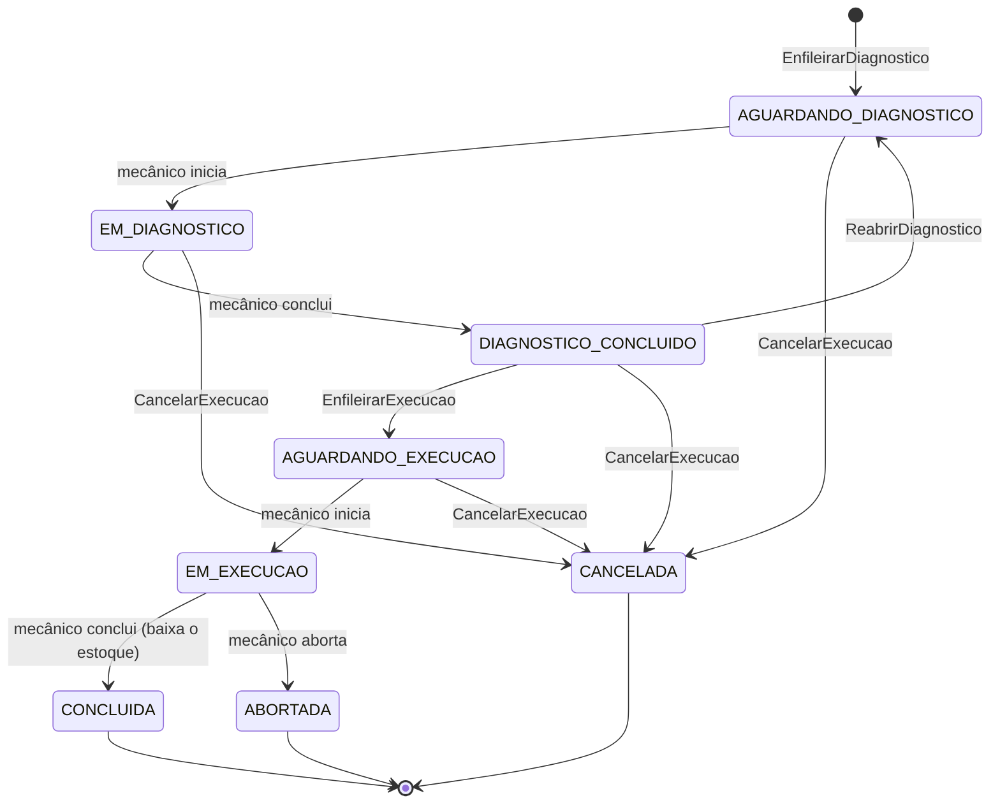

# oficina-execution-service

Execution Service da oficina mecânica — **fila, diagnóstico, execução e estoque de peças**.
Tech Challenge SOAT 13, Fase 4: um dos três microsserviços que substituem o monólito
`oficina-app`.

> **Status:** Passo 4, entregas E1 e E2 — **estoque de peças** (catálogo, entrada/saída, consulta
> interna de preços, `ReservarPecas`/`LiberarReserva`) e **fila, diagnóstico e execução** (endpoints do
> mecânico e os comandos da Saga), tudo no DynamoDB. A infraestrutura (`infra/`: tabelas, fila, ECR,
> IRSA) e o deploy têm código e pipeline prontos e **nunca foram aplicados** (a AWS só sobe no dia da
> gravação do vídeo).

## Responsabilidade

| Faz | Não faz |
|---|---|
| Fila de diagnóstico e de execução, em ordem de chegada | Não abre nem altera ordens de serviço — dono: OS Service |
| Diagnóstico (serviços com mão de obra e peças previstas), início, conclusão e aborto da execução | Não calcula orçamento nem cobra — dono: Billing Service |
| Catálogo e estoque de peças; reserva, consumo e liberação atômicos por OS | Não acessa o banco de nenhum outro serviço |
| Consulta interna de preços para o Billing (`POST /internal/pecas-insumos/consulta`) | |
| Publica os eventos que movem a Saga (`DiagnosticoConcluido`, `PecasReservadas`, `ExecucaoConcluida`…) | |

Banco: **DynamoDB** (o NoSQL exigido pela Fase 4).

### O que já está implementado (E1 e E2)

| Endpoint | Quem chama | Observação |
|---|---|---|
| `POST/GET/PUT/DELETE /pecas-insumos`, `GET /pecas-insumos/{id}` | Funcionário (JWT) | Mesmos caminhos do `pecainsumo` do OS Service. `PUT` não altera a quantidade reservada (ela é das reservas das OSs); `DELETE` é recusado com reserva ativa |
| `POST /pecas-insumos/{id}/adicionar-estoque`, `.../remover-estoque` | Funcionário (JWT) | Atômicos; a saída só tira do **disponível** |
| `POST /internal/pecas-insumos/consulta` | Billing (`X-Service-Token`) | [Contrato](https://github.com/soat13-oficina/oficina-app/blob/desenvolvimento/docs/contratos/rest-interno.md); não passa pelo API Gateway |
| comando `ReservarPecas` → `PecasReservadas` / `ReservaFalhou` | OS Service (`execution-commands`) | Tudo ou nada, em **uma** transação do DynamoDB |
| comando `LiberarReserva` → `ReservaLiberada` | OS Service (`execution-commands`) | Compensação; sem reserva, confirma com lista vazia |
| `GET /execucoes[?etapa=]`, `GET /execucoes/{osId}` | Funcionário (JWT) | A fila (diagnóstico, depois execução) em ordem de chegada; ou uma etapa; ou o documento da OS |
| `POST /execucoes/{osId}/diagnostico/iniciar` · `/diagnostico/concluir` | Mecânico (JWT) | Publicam `DiagnosticoIniciado` e `DiagnosticoConcluido` (serviços com mão de obra + peças, que precisam existir no catálogo): a Saga gera o orçamento sozinha |
| `POST /execucoes/{osId}/iniciar` · `/concluir` · `/abortar` | Mecânico (JWT) | `ExecucaoIniciada`; `ExecucaoConcluida` (**baixa do estoque** as peças reservadas, na mesma transação); `ExecucaoFalhou` (a Saga estorna e libera as reservas) |
| comandos `EnfileirarDiagnostico` → `DiagnosticoEnfileirado`, `ReabrirDiagnostico` → `DiagnosticoReaberto`, `EnfileirarExecucao` → `ExecucaoEnfileirada`, `CancelarExecucao` → `ExecucaoCancelada` | OS Service (`execution-commands`) | Idempotentes pelo estado; `CancelarExecucao` sempre confirma |

Não existem `reservar`, `liberar-reserva` e `consumir` por HTTP (o `pecainsumo` do OS tinha): toda
reserva tem uma OS dona e nasce de um comando da Saga; o consumo acontece na conclusão da execução.

### Etapas da execução



A OS é um documento na tabela `execucoes` (veículo, previsão, diagnóstico, mecânicos e histórico de etapas
aninhados). O GSI `fila-por-etapa` (`etapa` + `entrouNaEtapaEm`, texto de largura fixa para ordenar) é a
fila do mecânico. Toda escrita condiciona a `versao` lida: duas ações simultâneas sobre a mesma OS não se
atropelam (a segunda recebe `409`).

### Como o DynamoDB sustenta a Saga

- **Reserva atômica:** um `TransactWriteItems` com, por peça, um `Update` condicionado a
  `quantidadeDisponivel >= :q` e o `Put` da reserva, mais o item de idempotência e a resposta no
  outbox. O DynamoDB não aceita aritmética em `ConditionExpression`, por isso a peça guarda
  `quantidadeDisponivel` (derivado de `estoque − reservada`) — [ADR 0006](https://github.com/soat13-oficina/oficina-app/blob/desenvolvimento/docs/adr/0006-dynamodb-no-execution-service.md).
- **Unidade de trabalho:** o `@Transactional` da casa. Quem escreve dentro dela acrescenta itens ao
  lote da thread; o consumidor confirma tudo no fim. Perdeu a corrida pelo último item: a transação é
  recusada, a mensagem volta para a fila e a nova leitura responde `ReservaFalhou`.
- **Idempotência e outbox:** itens `MSG#<messageId>` e `OUTBOX#<messageId>` na tabela
  `oficina-<env>-execution-controle` (TTL de 7 dias em `expiraEm`). O publicador lê o GSI esparso
  `outbox-pendente` e uma concessão (`LOCK#outbox`) garante uma réplica por vez, no lugar do
  advisory lock do PostgreSQL usado no OS e no Billing.
- **Tabelas** (criadas pelo Terraform do [`infra/`](infra/README.md); localmente por `scripts/criar-tabelas-local.sh`):
  `oficina-<env>-pecas`, `-reservas`, `-execucoes` e `-execution-controle`.

## Arquitetura e decisões

As decisões da Fase 4 vivem no repositório que coordena a Saga (`oficina-app`):

- [ADR 0003 — divisão em microsserviços e dono dos dados](https://github.com/soat13-oficina/oficina-app/blob/desenvolvimento/docs/adr/0003-divisao-em-microsservicos-e-dono-dos-dados.md)
- [ADR 0004 — Saga orquestrada](https://github.com/soat13-oficina/oficina-app/blob/desenvolvimento/docs/adr/0004-saga-orquestrada.md)
- [ADR 0005 — SQS FIFO, outbox e idempotência](https://github.com/soat13-oficina/oficina-app/blob/desenvolvimento/docs/adr/0005-sqs-fifo-outbox-e-idempotencia.md)
- [ADR 0006 — DynamoDB no Execution Service](https://github.com/soat13-oficina/oficina-app/blob/desenvolvimento/docs/adr/0006-dynamodb-no-execution-service.md)
- [ADR 0008 — exposição por ALB](https://github.com/soat13-oficina/oficina-app/blob/desenvolvimento/docs/adr/0008-exposicao-e-roteamento.md)
- [Contratos das mensagens](https://github.com/soat13-oficina/oficina-app/blob/desenvolvimento/docs/contratos/mensagens.md) — este serviço consome `execution-commands` e publica em `os-saga-replies`
- [Convenções de nomes](https://github.com/soat13-oficina/oficina-app/blob/desenvolvimento/docs/arquitetura/convencoes-de-nomes.md)

## Stack

Java 21 · Spring Boot 4.0.5 (WebMVC, Security, Validation, Actuator) · jjwt 0.12 ·
springdoc-openapi 3 · Micrometer Prometheus · JaCoCo (gate de 80%) · SonarCloud ·
Kustomize · GitHub Actions · AWS SDK v2 (DynamoDB Enhanced Client e cliente de baixo nível, SQS) ·
Testcontainers + LocalStack.

## Segurança

Valida o JWT com o mesmo segredo do OS Service e da Lambda (`JWT_SECRET`,
`oficina/<env>/jwt-secret`). Não emite token e não tem tabela de usuários:

| Token | Origem | Papel |
|---|---|---|
| `tipo = CLIENTE` | Lambda `token` (login por CPF) | `ROLE_CLIENTE` |
| `tipo = FUNCIONARIO` ou sem `tipo` | OS Service (`POST /api/auth/login`) | `ROLE_FUNCIONARIO` (+ `roles`, se houver) |
| outro `tipo`, expirado, assinatura inválida | — | anônimo → `401` |

Estoque (`/pecas-insumos/**`) e execução (`/execucoes/**`) exigem `ROLE_FUNCIONARIO`; cliente recebe `403`. `/internal/**` é público para o JWT e protegido
pelo header `X-Service-Token` (segredo `oficina/<env>/service-token`, variável `SERVICE_TOKEN`; vazio
recusa tudo). Públicos: `/actuator/health/**`, `/actuator/prometheus` (em nuvem só na porta 8081,
fora do Ingress) e o Swagger.

## Rodando localmente

```sh
./mvnw spring-boot:run
```

- API: `http://localhost:8080`
- Swagger: `http://localhost:8080/swagger-ui.html`
- Health: `http://localhost:8080/actuator/health`

Sem variáveis, usa o segredo JWT de desenvolvimento (o mesmo default do `oficina-app`), então
um token emitido pelo OS rodando localmente é aceito aqui.

### Com DynamoDB e filas (LocalStack)

O LocalStack do `docker-compose` do `oficina-app` já liga SQS e DynamoDB e, ao subir, cria as filas da Saga
e as tabelas `oficina-local-*` (`scripts/localstack/` lá). Não precisa de AWS CLI para isso:

```sh
cd ../oficina-app && docker compose up -d localstack
```

Para carregar o catálogo de demonstração (precisa de AWS CLI e `jq`; as tabelas já existem):

```sh
export AWS_ENDPOINT_URL=http://localhost:4566 AWS_ACCESS_KEY_ID=test AWS_SECRET_ACCESS_KEY=test
scripts/carregar-seed-pecas.sh local      # 10 peças de demonstração (uma sem estoque)

AWS_ENDPOINT_URL_DYNAMODB=$AWS_ENDPOINT_URL AWS_ENDPOINT_URL_SQS=$AWS_ENDPOINT_URL \
MENSAGERIA_SQS_HABILITADO=true SERVICE_TOKEN=segredo-local ./mvnw spring-boot:run
```

Sem `AWS_ENDPOINT_URL_DYNAMODB` o cliente aponta para a AWS. Variáveis: `AMBIENTE` (padrão `local`:
prefixo das tabelas e filas), `AWS_REGION`, `MENSAGERIA_SQS_HABILITADO` (sem ele nada sai do outbox).
O `scripts/seed-pecas.json` usa ids fixos, para os roteiros de demonstração referenciarem as peças.

## Testes e cobertura

```sh
./mvnw clean verify
```

Roda os testes e o **gate do JaCoCo: mínimo de 80% de linhas e de branches no serviço
inteiro** — o build falha abaixo disso. Sem Docker rodam os testes de unidade, de web, de
contrato das mensagens (contra os JSON Schemas do OS Service) e os dos adapters com um duplo do
`DynamoDbClient`; o `EstoqueDynamoLocalStackTest` e `ExecucaoDynamoLocalStackTest` (Testcontainers + LocalStack: expressões,
transação, idempotência, corridas, fila pelo GSI, outbox → SQS) são ignorados e o CI os executa. Relatório em `target/site/jacoco/index.html` e como
artefato `jacoco-report` no CI. A análise do SonarCloud (job `qualidade`) usa o mesmo
relatório.

## CI/CD

| Job | Quando | O que faz |
|---|---|---|
| `testes` | PR e push | Build, testes e gate de cobertura |
| `qualidade` | PR e push | SonarCloud com quality gate bloqueante (exige o secret `SONAR_TOKEN`) |
| `validacao` | PR e push | `kubectl kustomize` dos overlays `hml` e `prd` |
| `guard` | PR para `homologacao`/`master` | Fluxo `feature/*` → `desenvolvimento` → `homologacao` → `master` |
| `build`, `deploy` | push em `homologacao`/`master`, ou *Run workflow* | Imagem no ECR (`oficina-execution-service-<env>`), Secrets, `kubectl apply -k` do overlay, rollout e — se a tabela de peças estiver vazia — o catálogo de demonstração |
| *Infra (Execution)* | *Run workflow* (`plan`/`apply`/`destroy`); em PR só `fmt`/`validate` | Terraform de [`infra/`](infra/README.md) |

Status checks obrigatórios em `master` e `homologacao`: `testes`, `qualidade`, `validacao`, `guard`.

## Kubernetes

`k8s/base` (ServiceAccount com IRSA, Deployment, Service `ClusterIP`, HPA, Ingress do ALB) e
`k8s/overlays/{hml,prd}`. O namespace (`oficina-hml`/`oficina-prd`) é compartilhado pelos três
serviços e não é criado aqui. Dentro do cluster: `http://oficina-execution-service:8080`.
